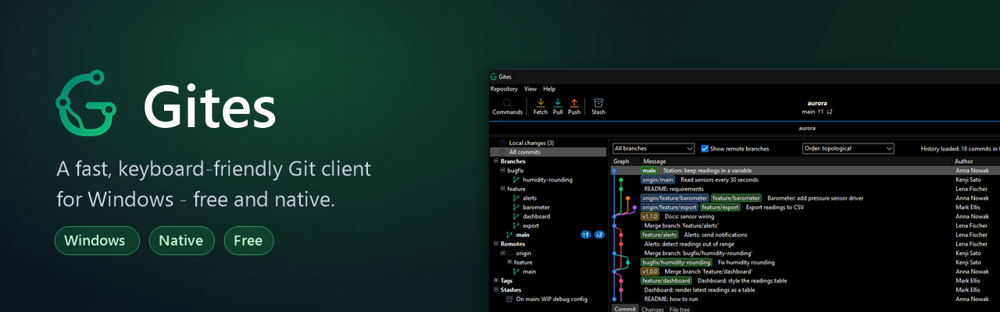
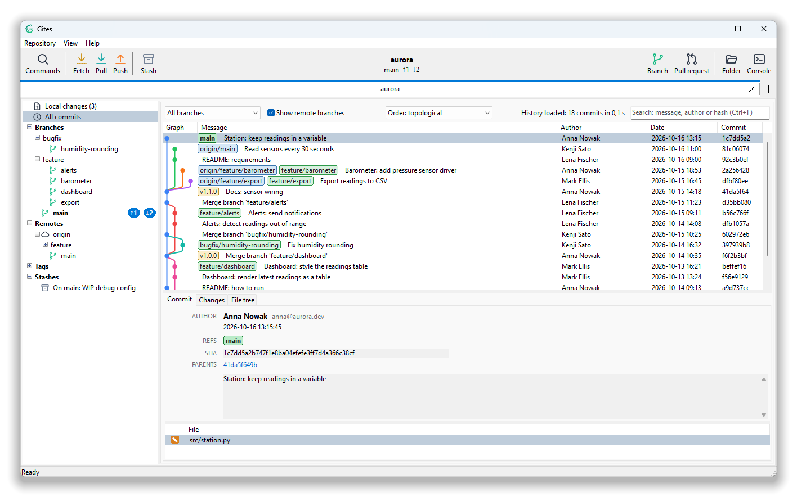
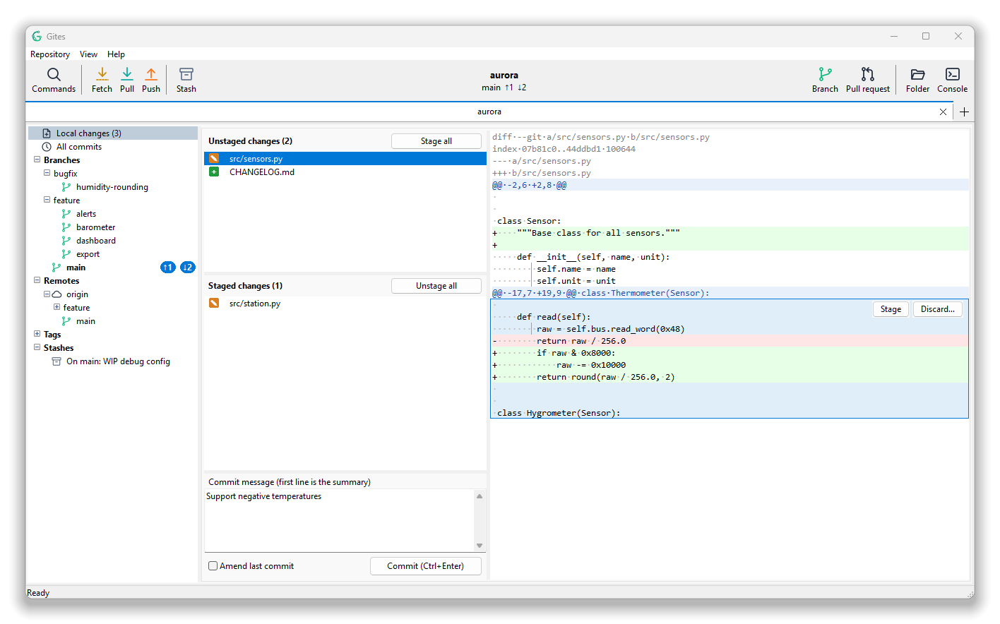

  

  
  
  
  

  <b>English</b> · <a href="README.pl.md">Polski</a>

---

**Gites** is a native Git client for Windows. It takes care of the everyday work: browsing history, picking
the exact lines that go into a commit, juggling branches, rebasing and resolving conflicts. It looks and feels
like a Windows app, starts instantly, and stays fast on repositories with hundreds of thousands of commits.

There is no installer, no runtime and no account. Download one `.exe`, run it, open your repository.

  <picture>
    <source media="(prefers-color-scheme: dark)" srcset="docs/history-dark.png">
    
  </picture>

## Why Gites

- **Fast on big repositories.** History is streamed and the lists are virtual, so a repository with 100,000+
  commits opens without a wait.
- **Line-by-line staging.** Point at a change and its whole hunk lights up, with *Stage* and *Discard* buttons
  right next to it. Or select only the lines you want.
- **Keyboard first.** Press `Ctrl+P` and type: every command, branch and tab is a few keystrokes away.
- **Honest about errors.** You get a clear message instead of raw Git output. The technical details are one
  click away, and you can send a report with a screenshot straight from the error window.
- **Native and light.** One `.exe` built with Delphi. It doesn't bundle a browser engine and uses Git for
  Windows under the hood.

## Features

  <picture>
    <source media="(prefers-color-scheme: dark)" srcset="docs/changes-dark.png">
    
  </picture>

**History**
- Commit graph with branch and tag badges, ahead/behind counters
- Filters: all branches or the current one, with or without remote branches, topological or date order
- Search by message, author or hash (`Ctrl+F`)
- Commit details: message, changed files, diff and a browsable file tree of any commit
- Blame and file history
- Copy file paths from a commit (full, relative, file names, or everything as text)

**Local changes**
- Stage, unstage and discard whole files, single hunks or selected lines
- Discard asks for confirmation and shows how many lines it will drop (you can turn the prompt off)
- Commit and amend, with your message kept exactly as written
- Live refresh when files change on disk
- Handles UTF-8 and legacy code pages (e.g. Windows-1250) in diffs and commit messages

**Branches and remotes**
- Branches grouped into folders (`feature/…`, `bugfix/…`), remotes, tags and stashes in one sidebar
- Create, rename, delete, check out and merge branches; set or remove upstream tracking
- Fetch, pull and push with a progress indicator; SSH passphrases asked in a dialog
- Cherry-pick, revert and stash

**Rebase and conflicts**
- Interactive rebase: reorder, squash, edit and reword commits
- Conflict window with *ours*, *base* and *theirs* side by side and an editable result
- A bar for operations in progress: *Continue*, *Skip*, *Abort*

**Hosting**
- Gitea: create pull requests and browse open ones without leaving the app; open a commit in the browser
- Access tokens are stored in Windows Credential Manager

**Comfort**
- Tabs for several repositories, restored on the next start
- Light, dark or system theme
- Zoom the whole interface (`Ctrl+=`, `Ctrl+-`, `Ctrl+0`)
- English and Polish interface
- Automatic updates with SHA-256 verification

## Download

1. Install [Git for Windows](https://git-scm.com/download/win) if you don't have it yet.
2. Get the latest **[Gites-win64.exe](https://github.com/woolfik/gites/releases/latest)** (or `Gites-win32.exe`
   for 32-bit Windows).
3. Run it. Gites keeps its settings in `%APPDATA%\Gites` and checks for updates on its own.

## Keyboard shortcuts

| Shortcut | Action | Shortcut | Action |
|---|---|---|---|
| `Ctrl+P` | Command palette | `Ctrl+Shift+F` | Fetch |
| `Ctrl+O` | Open repository | `Ctrl+Shift+L` | Pull |
| `Ctrl+W` | Close tab | `Ctrl+Shift+P` | Push |
| `Ctrl+Tab` | Next tab | `Ctrl+Shift+S` | Stash |
| `Ctrl+1` / `Ctrl+2` | History / Local changes | `Ctrl+Shift+B` | New branch |
| `Ctrl+F` | Search history | `Ctrl+Shift+R` | New pull request |
| `Ctrl+Enter` | Commit | `F5` | Refresh |
| `Ctrl+,` | Settings | `Ctrl+=` / `Ctrl+-` | Zoom in / out |

## Feedback

Found a bug? Use **Help > Report a problem** in the app, or open an
[issue](https://github.com/woolfik/gites/issues). The error window can attach a screenshot and the recent log
for you.

---

This repository hosts the Gites releases.

