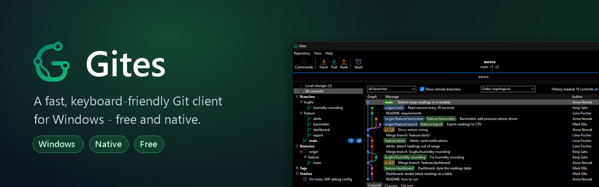
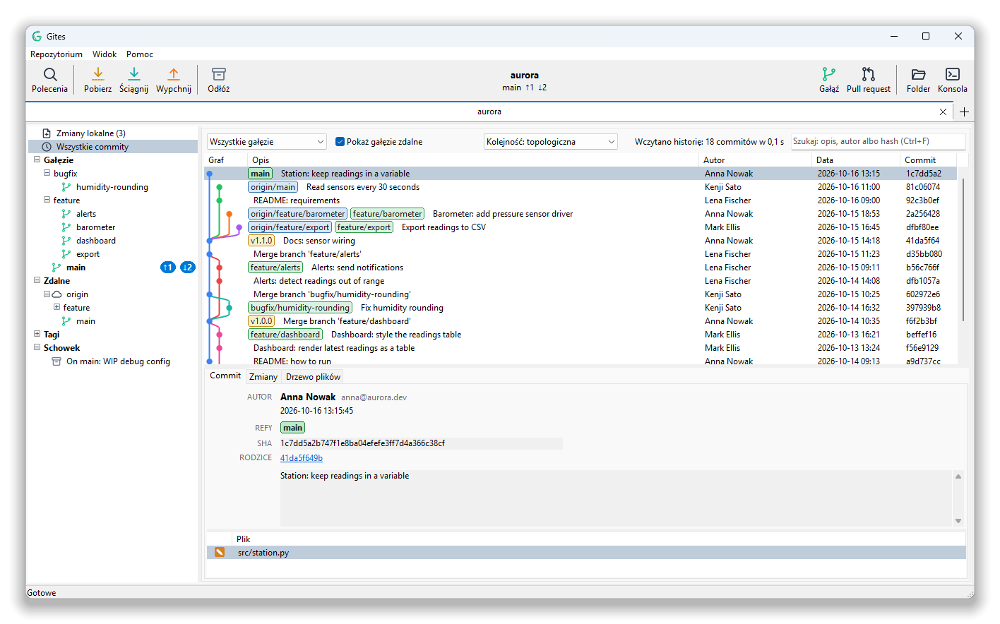
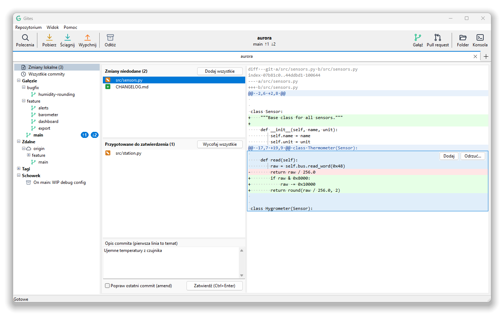

  

  
  
  
  

  <a href="README.md">English</a> · <b>Polski</b>

---

**Gites** to natywny klient Gita dla Windows. Ogarnia codzienną pracę: przeglądanie historii, wybieranie
dokładnie tych linii, które mają trafić do commita, gałęzie, rebase i konflikty. Wygląda i działa jak
program dla Windows, uruchamia się od razu i nie zwalnia nawet przy repozytoriach z setkami tysięcy commitów.

Bez instalatora, bez dodatkowych bibliotek i bez zakładania konta. Pobierasz jeden `.exe`, uruchamiasz
i otwierasz repozytorium.

  

## Dlaczego Gites

- **Szybki przy dużych repozytoriach.** Historia wczytuje się strumieniowo, a listy są wirtualne, więc
  repozytorium ze 100 000+ commitów otwiera się bez czekania.
- **Dodawanie po linii.** Najedź na zmianę, a cały fragment podświetli się z przyciskami *Dodaj*
  i *Odrzuć* tuż obok. Możesz też zaznaczyć tylko wybrane linie.
- **Klawiatura na pierwszym miejscu.** `Ctrl+P` i kilka liter, a masz każde polecenie, gałąź czy zakładkę.
- **Zrozumiałe błędy.** Zamiast surowego wyjścia Gita dostajesz jasny komunikat. Szczegóły techniczne są pod
  jednym kliknięciem, a zgłoszenie ze zrzutem ekranu wyślesz prosto z okna błędu.
- **Natywny i lekki.** Jeden `.exe` napisany w Delphi. Nie ciągnie za sobą przeglądarki, a pod spodem używa
  Git for Windows.

## Możliwości

  

**Historia**
- Graf commitów z oznaczeniami gałęzi i tagów oraz licznikami commitów przed i za zdalną gałęzią
- Filtry: wszystkie gałęzie albo bieżąca, z gałęziami zdalnymi albo bez, kolejność topologiczna albo wg daty
- Wyszukiwanie po opisie, autorze lub hashu (`Ctrl+F`)
- Szczegóły commita: opis, zmienione pliki, diff i drzewo plików z dowolnego commita
- Blame i historia pliku
- Kopiowanie ścieżek plików z commita (pełne, względne, same nazwy albo wszystko jako tekst)

**Zmiany lokalne**
- Dodawanie, wycofywanie i odrzucanie całych plików, pojedynczych fragmentów albo zaznaczonych linii
- Przy odrzucaniu program pyta i mówi, ile linii przepadnie (pytanie można wyłączyć)
- Commit i amend, z opisem zapisanym dokładnie tak, jak go wpiszesz
- Odświeżanie na bieżąco, gdy pliki zmieniają się na dysku
- Obsługa UTF-8 i starszych stron kodowych (np. Windows-1250) w diffach i opisach commitów

**Gałęzie i serwery zdalne**
- Gałęzie w folderach (`feature/…`, `bugfix/…`), serwery zdalne, tagi i schowek w jednym panelu
- Tworzenie, zmiana nazwy, usuwanie, przełączanie i scalanie gałęzi; ustawianie i usuwanie śledzenia
- Pobierz, ściągnij i wypchnij ze wskaźnikiem postępu; hasło do klucza SSH w osobnym okienku
- Cherry-pick, revert i odkładanie zmian (stash)

**Rebase i konflikty**
- Interaktywny rebase: zmiana kolejności, łączenie, edycja i zmiana opisu commitów
- Okno konfliktu z wersjami *nasza*, *bazowa* i *ich* obok siebie oraz edytowalnym wynikiem
- Pasek trwającej operacji: *Kontynuuj*, *Pomiń*, *Przerwij*

**Hosting**
- Gitea: tworzenie pull requestów i przeglądanie otwartych bez wychodzenia z programu; commit w przeglądarce
- Tokeny dostępu przechowywane w Menedżerze poświadczeń Windows

**Wygoda**
- Zakładki z wieloma repozytoriami, przywracane przy kolejnym uruchomieniu
- Motyw jasny, ciemny albo systemowy
- Powiększanie całego interfejsu (`Ctrl+=`, `Ctrl+-`, `Ctrl+0`)
- Interfejs po polsku i po angielsku
- Automatyczne aktualizacje ze sprawdzaniem sumy SHA-256

## Pobieranie

1. Zainstaluj [Git for Windows](https://git-scm.com/download/win), jeśli jeszcze go nie masz.
2. Pobierz najnowszy **[Gites-win64.exe](https://github.com/woolfik/gites/releases/latest)** (albo
   `Gites-win32.exe` dla 32-bitowego Windows).
3. Uruchom. Gites trzyma ustawienia w `%APPDATA%\Gites` i sam sprawdza aktualizacje.

## Skróty klawiszowe

| Skrót | Działanie | Skrót | Działanie |
|---|---|---|---|
| `Ctrl+P` | Paleta poleceń | `Ctrl+Shift+F` | Pobierz (fetch) |
| `Ctrl+O` | Otwórz repozytorium | `Ctrl+Shift+L` | Ściągnij (pull) |
| `Ctrl+W` | Zamknij zakładkę | `Ctrl+Shift+P` | Wypchnij (push) |
| `Ctrl+Tab` | Następna zakładka | `Ctrl+Shift+S` | Odłóż (stash) |
| `Ctrl+1` / `Ctrl+2` | Historia / Zmiany lokalne | `Ctrl+Shift+B` | Nowa gałąź |
| `Ctrl+F` | Szukaj w historii | `Ctrl+Shift+R` | Nowy pull request |
| `Ctrl+Enter` | Zatwierdź (commit) | `F5` | Odśwież |
| `Ctrl+,` | Ustawienia | `Ctrl+=` / `Ctrl+-` | Powiększ / pomniejsz |

## Zgłaszanie uwag

Znalazłeś błąd? Użyj **Pomoc > Zgłoś problem** w programie albo załóż
[zgłoszenie (issue)](https://github.com/woolfik/gites/issues). Okno błędu samo dołączy zrzut ekranu
i ostatnie wpisy z dziennika.

---

To repozytorium zawiera wydania programu Gites.

